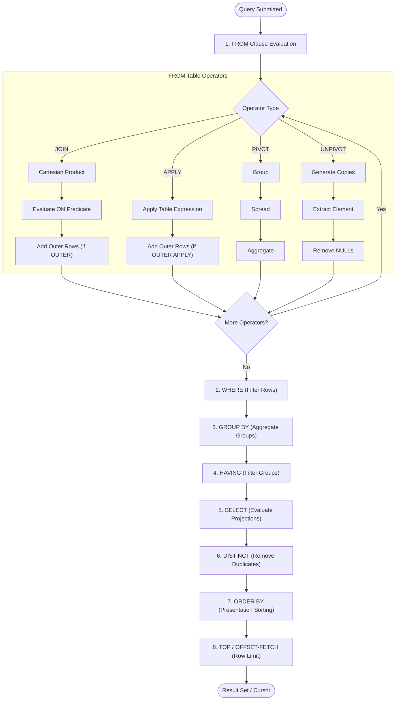

# Advanced SQL Joins: Thinking in Sets

Author: **Scott Peters** | [https://advancedsqlpuzzles.com](https://advancedsqlpuzzles.com)  
Companion SQL Code: [`Advanced SQL Joins SQL Statements.sql`](file:///c:/Users/amitt/Documents/github/Advancesqlpuzzle/Database%20Writings/Advanced%20SQL%20Joins/Advanced%20SQL%20Joins%20SQL%20Statements.sql)

---

## Executive Summary

The most essential concept of understanding SQL is how **joins** operate. Any SQL statement that combines rows from two or more tables, views, or table-valued functions must make use of a join or set operation.

At its mathematical core, **there is only one true type of table join: the Cartesian product**. All other joins—`INNER JOIN`, `LEFT OUTER JOIN`, `RIGHT OUTER JOIN`, `FULL OUTER JOIN`—are **restricted Cartesian products**, where the `ON` predicate specifies the restriction.

This document breaks down the logical query processing order, join algorithms, Venn diagram misconceptions, NULL behaviors, self-joins, running totals, and advanced graph-like problem solving in relational databases.

---

## Table of Contents
1. [Logical Query Processing Order](#1-logical-query-processing-order)
2. [Physical Join Algorithms](#2-physical-join-algorithms)
3. [Join Diagrams vs. Venn Diagrams](#3-join-diagrams-vs-venn-diagrams)
4. [Sample Data Definitions](#4-sample-data-definitions)
5. [Inner Joins & Restricted Cartesian Products](#5-inner-joins--restricted-cartesian-products)
6. [Outer Joins (`LEFT`, `RIGHT`, `FULL`)](#6-outer-joins-left-right-full)
7. [Natural Joins](#7-natural-joins)
8. [Cross Joins](#8-cross-joins)
9. [Semi-Joins and Anti-Joins](#9-semi-joins-and-anti-joins)
10. [NULL Markers in Joins](#10-null-markers-in-joins)
11. [The `VALUES` Keyword as an Inline Derived Table](#11-the-values-keyword-as-an-inline-derived-table)
12. [Set Operators vs. Joins](#12-set-operators-vs-joins)
13. [Self-Joins & Hierarchies](#13-self-joins--hierarchies)
14. [Case Study: The "Positive Balances" Problem (5 Solutions)](#14-case-study-the-positive-balances-problem-5-solutions)
15. [Case Study: The "Mutual Friends" Graph Problem (Step-by-Step)](#15-case-study-the-mutual-friends-graph-problem-step-by-step)
16. [Conclusion](#16-conclusion)

---

## 1. Logical Query Processing Order

SQL is a declarative language written in a specific syntax, but processed internally by database engines in a very different order:

1. **`FROM`** (including table operators: `JOIN`, `APPLY`, `PIVOT`, `UNPIVOT`)
2. **`WHERE`** (row-level filtering)
3. **`GROUP BY`** (aggregation grouping)
4. **`HAVING`** (group-level filtering)
5. **`SELECT`** (evaluating expressions and projections)
6. **`DISTINCT`** (removing duplicate rows)
7. **`ORDER BY`** (ordering presentation)
8. **`TOP` / `OFFSET-FETCH`** (limiting output rows)

### Logical Query Processing Flowchart



---

## 2. Physical Join Algorithms

When executing a query, the query optimizer evaluates available indexes, statistics, and cardinality to pick one of three fundamental physical join operators:

| Algorithm | Mechanism | Best Suited For | Non-Equi Joins? |
|:---|:---|:---|:---:|
| **Nested Loops** | For each row in the outer table, scans/seeks the inner table. | High selectivity; one table is small, other has a supporting index. | **Yes** (Only algorithm supporting non-equi joins) |
| **Merge Join** | Simultaneously traverses two pre-sorted inputs on equality keys. | Large pre-sorted inputs (e.g. clustered index scans). Highly efficient. | **No** (Requires equi-join) |
| **Hash Match** | Builds an in-memory hash table on the smaller input, then probes with the larger input. | Large, unsorted tables without indexes. High memory/tempdb usage. | **No** (Requires equi-join) |

---

## 3. Join Diagrams vs. Venn Diagrams

> [!IMPORTANT]
> **Venn diagrams represent Set Theory, not Relational Join Theory.**  
> A Venn diagram illustrates sets of identical types sharing common elements (Union, Intersection, Difference). Joins, by contrast, combine attributes (columns) from different relations based on predicates, often producing row multiplication (Cartesian products). For example, a Venn diagram cannot visually represent a `CROSS JOIN` or row duplication.

### Relational Join Matrix

```text
Table A: [1, 2, 3]    Table B: [A, B, C]

CROSS JOIN (All Permutations: 3 x 3 = 9 rows):
(1, A), (1, B), (1, C), (2, A), (2, B), (2, C), (3, A), (3, B), (3, C)

INNER JOIN (Matched on Key):
(2, A), (3, B)

LEFT JOIN (All Left preserved + Null right):
(1, NULL), (2, A), (3, B)

FULL OUTER JOIN (All Left + All Right preserved):
(1, NULL), (2, A), (3, B), (NULL, C)
```

---

## 4. Sample Data Definitions

```sql
DROP TABLE IF EXISTS ##TableA;
DROP TABLE IF EXISTS ##TableB;
GO

CREATE TABLE ##TableA
(
    ID       TINYINT,
    Fruit    VARCHAR(10),
    Quantity TINYINT
);
GO

CREATE TABLE ##TableB
(
    ID       TINYINT,
    Fruit    VARCHAR(10),
    Quantity TINYINT
);
GO

INSERT INTO ##TableA VALUES
(1, 'Apple', 17),
(2, 'Peach', 20),
(3, 'Mango', 11),
(4, NULL, 5);
GO

INSERT INTO ##TableB VALUES
(1, 'Apple', 17),
(2, 'Peach', 25),
(3, 'Kiwi', 20),
(4, NULL, NULL);
GO
```

---

## 5. Inner Joins & Restricted Cartesian Products

An `INNER JOIN` filters the Cartesian product to retain only records satisfying the `ON` predicate.

### 5.1 Standard ANSI-92 Equi-Join
```sql
-- 1.1
SELECT a.Fruit, b.Fruit
FROM   ##TableA a
INNER JOIN ##TableB b ON a.Fruit = b.Fruit;
```
Output:
| a.Fruit | b.Fruit |
|:---|:---|
| `Apple` | `Apple` |
| `Peach` | `Peach` |

### 5.2 Legacy SQL-89 Comma Join
```sql
-- 1.2
SELECT a.Fruit, b.Fruit
FROM   ##TableA a, ##TableB b
WHERE  a.Fruit = b.Fruit;
```

### 5.3 Non-Equi Join (Theta Join)
Non-equi joins look for conditions other than equality (`<`, `>`, `<=`, `>=`, `<>`, `BETWEEN`):
```sql
-- 1.4 Find matching fruits with differing quantities:
SELECT a.Fruit, b.Fruit
FROM   ##TableA a
INNER JOIN ##TableB b 
    ON a.Fruit = b.Fruit 
   AND a.Quantity <> b.Quantity;
-- Output: Peach | Peach (Table A has 20, Table B has 25)

-- 1.7 Non-equi quantity comparison:
SELECT *
FROM   ##TableA a
INNER JOIN ##TableB b ON a.Quantity >= b.Quantity;
```

---

## 6. Outer Joins (`LEFT`, `RIGHT`, `FULL`)

In an `OUTER JOIN`, the join predicate acts as a **matching criterion**, not an absolute filter. Rows from the preserved table that fail the `ON` predicate are retained with `NULL` populated for the non-preserved columns.

### 6.1 `LEFT OUTER JOIN`
```sql
-- 2.1
SELECT a.Fruit, b.Fruit
FROM   ##TableA a
LEFT OUTER JOIN ##TableB b ON a.Fruit = b.Fruit;
```
Output:
| a.Fruit | b.Fruit |
|:---|:---|
| `Apple` | `Apple` |
| `Peach` | `Peach` |
| `Mango` | *NULL* |
| *NULL* | *NULL* |

### 6.2 Critical Trap: Predicate in `ON` vs. `WHERE`
- **In `ON`:** Restricts matches from the right table; left table rows remain preserved.
- **In `WHERE`:** Filters the entire result set after join; converts the outer join into an **inner join**!

```sql
-- 2.3 Predicate in ON clause (all left rows preserved):
SELECT a.Fruit, b.Fruit
FROM   ##TableA a
LEFT OUTER JOIN ##TableB b 
    ON a.Fruit = b.Fruit 
   AND b.Fruit = 'Apple';
-- Output: Apple/Apple, Peach/NULL, Mango/NULL, NULL/NULL

-- 2.4 Predicate in WHERE clause (converts to inner join):
SELECT a.Fruit, b.Fruit
FROM   ##TableA a
LEFT OUTER JOIN ##TableB b ON a.Fruit = b.Fruit
WHERE  b.Fruit = 'Apple';
-- Output: Only Apple/Apple
```

### 6.3 `FULL OUTER JOIN`
Preserves un-matched records from **both** tables:
```sql
-- 3.1
SELECT a.Fruit, b.Fruit
FROM   ##TableA a
FULL OUTER JOIN ##TableB b ON a.Fruit = b.Fruit;
```
Output:
| a.Fruit | b.Fruit |
|:---|:---|
| `Apple` | `Apple` |
| `Peach` | `Peach` |
| `Mango` | *NULL* |
| *NULL* | *NULL* |
| *NULL* | `Kiwi` |
| *NULL* | *NULL* |

```sql
-- 3.2 Finding discrepancies between two baskets:
SELECT a.Fruit, b.Fruit
FROM   ##TableA a
FULL OUTER JOIN ##TableB b ON a.Fruit = b.Fruit
WHERE  a.Fruit IS NULL OR b.Fruit IS NULL;
```

---

## 7. Natural Joins

A `NATURAL JOIN` (supported in Oracle, PostgreSQL, MySQL, but **not** in Microsoft SQL Server) automatically joins tables by matching all columns sharing the same name and data type:

```sql
-- ANSI Standard / Oracle:
SELECT *
FROM Countries NATURAL JOIN Cities;
```

---

## 8. Cross Joins

A `CROSS JOIN` computes the full Cartesian product ($M \times N$ rows):
```sql
-- 5.1
SELECT a.Fruit, b.Fruit
FROM   ##TableA a
CROSS JOIN ##TableB b;
-- Produces 4 x 4 = 16 rows
```

---

## 9. Semi-Joins and Anti-Joins

A **semi-join** returns each outer row at most once if a match exists (using `IN` or `EXISTS`).  
An **anti-join** returns outer rows that have no match (using `NOT IN` or `NOT EXISTS`).

```sql
-- 6.4 Semi-Join using IN
SELECT Fruit
FROM   ##TableA
WHERE  Fruit IN (SELECT Fruit FROM ##TableB);
-- Output: Apple, Peach

-- 6.6 Semi-Join using EXISTS (supports multi-column predicates)
SELECT Fruit
FROM   ##TableA a
WHERE  EXISTS (
    SELECT 1 
    FROM   ##TableB b 
    WHERE  a.Fruit = b.Fruit AND a.Quantity = b.Quantity
);
-- Output: Apple (both have quantity 17)
```

> [!CAUTION]
> Remember: `NOT IN` returns `<Empty Data Set>` if the subquery returns any `NULL`. Always use `NOT EXISTS` for production anti-joins!

---

## 10. NULL Markers in Joins

- In `INNER JOIN`, NULL never matches NULL because `NULL = NULL` is `UNKNOWN`.
- To treat NULLs as equal in join conditions:
```sql
-- 1.9 Joining with ISNULL coalescing:
SELECT a.Fruit, b.Fruit
FROM   ##TableA a
INNER JOIN ##TableB b 
    ON ISNULL(a.Fruit, '') = ISNULL(b.Fruit, '');
```

---

## 11. The `VALUES` Keyword as an Inline Derived Table

The `VALUES` constructor can be queried directly in the `FROM` clause as a virtual derived table without creating temporary tables:

```sql
-- 8.1 Virtual table with 5 rows and 2 columns
SELECT a, b
FROM   (VALUES (1, 2), (3, 4), (5, 6), (7, 8), (9, 10)) AS MyTable(a, b);

-- 8.2 Joining a table to an inline list of values
SELECT a.Fruit
FROM   ##TableA a
INNER JOIN (VALUES ('Kiwi'), ('Apple')) AS b(Fruit)
    ON a.Fruit = b.Fruit;
```

---

## 12. Set Operators vs. Joins

- **Joins** combine **columns** from separate tables of different types.
- **Set Operators** combine **rows** from relations of the **same type**.

```sql
-- 9.1 UNION (deduplicates NULLs)
SELECT Fruit FROM ##TableA
UNION
SELECT Fruit FROM ##TableB;

-- 9.3 INTERSECT (returns mutual items including NULL)
SELECT Fruit FROM ##TableA
INTERSECT
SELECT Fruit FROM ##TableB;

-- 9.4 EXCEPT (items in Table A not in Table B)
SELECT Fruit FROM ##TableA
EXCEPT
SELECT Fruit FROM ##TableB;
```

---

## 13. Self-Joins & Hierarchies

A self-join (unary relationship) joins a table to itself.

### 13.1 Manager-Employee Hierarchy
```sql
DROP TABLE IF EXISTS #Employees;
CREATE TABLE #Employees
(
    EmployeeID INT PRIMARY KEY,
    Name       VARCHAR(50),
    Title      VARCHAR(50),
    ManagerID  INT
);

INSERT INTO #Employees VALUES
(1, 'Ramirez', 'President', NULL),
(2, 'Baers', 'Vice President', 1),
(3, 'Santana', 'Vice President', 1),
(4, 'Perkins', 'Director', 2),
(5, 'Mercer', 'Director', 3);

-- 10.1 Self-Join
SELECT a.EmployeeID, a.Name, a.Title,
       b.Name AS ManagerName, b.Title AS ManagerTitle
FROM   #Employees a
INNER JOIN #Employees b ON a.ManagerID = b.EmployeeID;

-- 10.2 Recursive CTE for Organizational Depth
WITH cte_Recursion AS
(
    SELECT EmployeeID, Name, Title, ManagerID, 0 AS Depth
    FROM   #Employees
    WHERE  ManagerID IS NULL
    UNION ALL
    SELECT b.EmployeeID, b.Name, b.Title, b.ManagerID, a.Depth + 1 AS Depth
    FROM   cte_Recursion a
    INNER JOIN #Employees b ON a.EmployeeID = b.ManagerID
)
SELECT a.EmployeeID, a.Name, a.Title, a.ManagerID,
       b.Name AS ManagerName, a.Depth
FROM   cte_Recursion a
LEFT JOIN #Employees b ON a.ManagerID = b.EmployeeID
ORDER BY a.Depth, a.EmployeeID;
```

### 13.2 Running Totals: Self-Join vs Window Function
```sql
DROP TABLE IF EXISTS #Animals;
CREATE TABLE #Animals (ID INT PRIMARY KEY, Animal VARCHAR(50), Weight INT);
INSERT INTO #Animals VALUES (1, 'Elephant', 13000), (2, 'Rhinoceros', 8000), (3, 'Hippopotamus', 3000), (4, 'Giraffe', 2000), (5, 'Water Buffalo', 2000);

-- 10.5 Self-Join approach (O(N^2) complexity):
SELECT a.ID, a.Animal, SUM(b.Weight) AS Cumulative_Weight
FROM   #Animals a
CROSS JOIN #Animals b
WHERE  a.ID >= b.ID
GROUP BY a.ID, a.Animal;

-- 10.6 Window Function approach (O(N) complexity - Preferred!):
SELECT ID, Animal,
       SUM(Weight) OVER (ORDER BY ID ROWS BETWEEN UNBOUNDED PRECEDING AND CURRENT ROW) AS Cumulative_Weight
FROM   #Animals;
```

---

## 14. Case Study: The "Positive Balances" Problem (5 Solutions)

**Puzzle:** Given account balances with deposits and overdrafts, return accounts that have **never had a positive balance**.

```sql
DROP TABLE IF EXISTS #AccountBalances;
CREATE TABLE #AccountBalances (ID INT, Balance INT);
INSERT INTO #AccountBalances VALUES
(45643, -123), (45643, -343), (45643, -34),
(18797, -45),  (18797, -56),  (18797, 67),  (18797, 78),
(87765, 12),   (87765, 567),  (87765, 343);
```

### Solution 1: `EXCEPT` Set Operator
```sql
SELECT DISTINCT ID FROM #AccountBalances WHERE Balance < 0
EXCEPT
SELECT DISTINCT ID FROM #AccountBalances WHERE Balance > 0;
```

### Solution 2: `HAVING` with `MAX()`
```sql
SELECT ID
FROM   #AccountBalances
GROUP BY ID
HAVING MAX(Balance) < 0;
```

### Solution 3: `NOT IN` Subquery
```sql
SELECT DISTINCT ID
FROM   #AccountBalances
WHERE  ID NOT IN (SELECT ID FROM #AccountBalances WHERE Balance > 0);
```

### Solution 4: `NOT EXISTS` Subquery
```sql
SELECT DISTINCT a.ID
FROM   #AccountBalances a
WHERE  NOT EXISTS (
    SELECT 1 FROM #AccountBalances b WHERE b.Balance > 0 AND a.ID = b.ID
);
```

### Solution 5: `LEFT OUTER JOIN` with `IS NULL` Check
```sql
SELECT DISTINCT a.ID
FROM   #AccountBalances a
LEFT OUTER JOIN #AccountBalances b 
    ON a.ID = b.ID AND b.Balance > 0
WHERE  b.ID IS NULL;
```

---

## 15. Case Study: The "Mutual Friends" Graph Problem (Step-by-Step)

**Problem:** Given bidirectional social friendships, calculate the number of mutual friends between each pair of individuals.

```sql
DROP TABLE IF EXISTS #Friends;
CREATE TABLE #Friends (Friend1 VARCHAR(20), Friend2 VARCHAR(20));
INSERT INTO #Friends VALUES
('Jason', 'Mary'), ('Mike', 'Mary'), ('Mike', 'Jason'),
('Susan', 'Jason'), ('John', 'Mary'), ('Susan', 'Mary');
```

### Step 1: Create Symmetrical Reciprocals
```sql
WITH cte_Reciprocal AS (
    SELECT Friend1, Friend2 FROM #Friends
    UNION
    SELECT Friend2, Friend1 FROM #Friends
)
SELECT * INTO #Step1 FROM cte_Reciprocal;
```

### Step 2: Self-Join to Identify Candidate Mutual Connections
```sql
SELECT a.Friend1, a.Friend2, b.Friend2 AS Mutual_Friend_Candidate
INTO   #Step2
FROM   #Step1 a
INNER JOIN #Step1 b ON a.Friend2 = b.Friend1
WHERE  a.Friend1 <> b.Friend2;
```

### Step 3: Canonicalize Friend Pair Ordering
Alphabetize pairs so `(Jason, Mary)` and `(Mary, Jason)` map to the same row representation:
```sql
SELECT CASE WHEN Friend1 < Friend2 THEN Friend1 ELSE Friend2 END AS Friend1,
       CASE WHEN Friend1 < Friend2 THEN Friend2 ELSE Friend1 END AS Friend2,
       Mutual_Friend_Candidate
INTO   #Step3
FROM   #Step2;
```

### Step 4: Group and Count Candidates
```sql
SELECT Friend1, Friend2, Mutual_Friend_Candidate,
       COUNT(*) AS Grouping_Count
INTO   #Step4
FROM   #Step3
GROUP BY Friend1, Friend2, Mutual_Friend_Candidate;
```

### Step 5 & 6: Verify Mutual Pairings and Aggregate
A candidate with a count of 2 indicates that both individuals share the friend:
```sql
SELECT Friend1, Friend2,
       SUM(CASE WHEN Grouping_Count = 2 THEN 1 ELSE 0 END) AS Total_Mutual_Friends
FROM   #Step4
GROUP BY Friend1, Friend2
ORDER BY Total_Mutual_Friends DESC;
```

#### Final Output:
| Friend 1 | Friend 2 | Total Mutual Friends |
|:---|:---|:---:|
| `Jason` | `Mary` | **2** (`Mike`, `Susan`) |
| `Jason` | `Mike` | **1** (`Mary`) |
| `Jason` | `Susan`| **1** (`Mary`) |
| `Mary`  | `Mike` | **1** (`Jason`) |
| `Mary`  | `Susan`| **1** (`Jason`) |
| `John`  | `Mary` | **0** |

---

## 16. Conclusion

- **Restricted Cartesian Products:** Every join begins as a Cartesian product restricted by the `ON` clause, followed by optional outer row injection.
- **`ON` vs `WHERE`:** Filters in `ON` determine matching eligibility; filters in `WHERE` determine final row retention.
- **Performance:** Prefer Window Functions over self-joins for running totals, and utilize `NOT EXISTS` over `NOT IN` to prevent NULL hazards.

