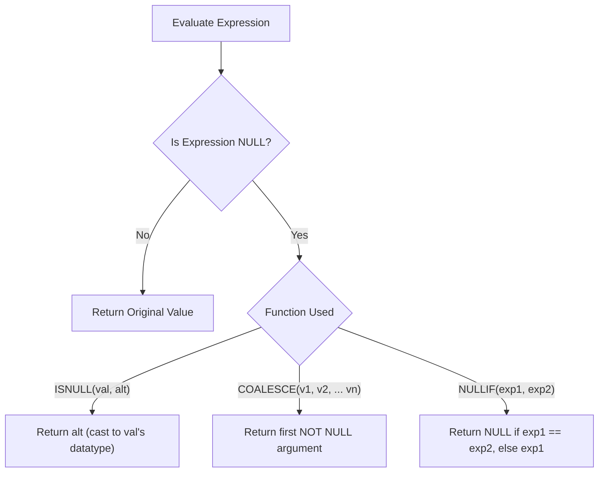

# Behavior of NULLs in SQL

Author: **Scott Peters** | [https://advancedsqlpuzzles.com](https://advancedsqlpuzzles.com)  
Companion SQL Code: [`Behavior of Nulls SQL Statements.sql`](file:///c:/Users/amitt/Documents/github/Advancesqlpuzzle/Database%20Writings/Behavior%20Of%20Nulls/Behavior%20of%20Nulls%20SQL%20Statements.sql)

---

## Executive Summary

To record missing or unknown values, relational database management systems assign **NULL markers** to columns. **NULL is not a data value**, but a marker representing the **absence of a value**.

NULL markers generally convey one of two meanings:
1. **Inapplicable:** The attribute does not apply to the entity or record (e.g., maiden name for an unmarried male).
2. **Missing / Unknown:** The attribute applies, but the actual value is currently unknown or unrecorded.

Because NULL markers represent the absence of a value, they introduce Three-Valued Logic (3VL) into relational databases. The SQL standard treats NULL markers differently across language constructs:
- Join predicates treat NULLs as neither equal nor not equal (yielding `UNKNOWN`).
- Set operators (`UNION`, `INTERSECT`, `EXCEPT`) treat NULLs as **not distinct from each other**.
- `GROUP BY` collapses all NULLs into a single group.
- `CHECK` constraints accept `UNKNOWN` (evaluating as not false).
- A `UNIQUE` constraint in Microsoft SQL Server allows only a **single NULL entry**.

---

## Table of Contents
1. [Predicate Logic & Three-Valued Logic (3VL)](#1-predicate-logic--three-valued-logic-3vl)
2. [ANSI_NULLS Setting & Comparison Conditions](#2-ansi_nulls-setting--comparison-conditions)
3. [Sample Data Definitions](#3-sample-data-definitions)
4. [Inner Joins](#4-inner-joins)
5. [Semi-Joins and Anti-Joins (The `NOT IN` Trap)](#5-semi-joins-and-anti-joins-the-not-in-trap)
6. [Set Operators (`UNION`, `EXCEPT`, `INTERSECT`)](#6-set-operators-union-except-intersect)
7. [GROUP BY Aggregation](#7-group-by-aggregation)
8. [COUNT(*) vs COUNT(column)](#8-count-vs-countcolumn)
9. [Constraints (PRIMARY KEY, UNIQUE, CHECK)](#9-constraints-primary-key-unique-check)
10. [Referential Integrity & Foreign Keys](#10-referential-integrity--foreign-keys)
11. [Computed Columns & Arithmetic Propagation](#11-computed-columns--arithmetic-propagation)
12. [SQL Functions: COALESCE, ISNULL, NULLIF](#12-sql-functions-coalesce-isnull-nullif)
13. [Empty Strings vs NULL](#13-empty-strings-vs-null)
14. [Architectural Takeaways & Best Practices](#14-architectural-takeaways--best-practices)

---

## 1. Predicate Logic & Three-Valued Logic (3VL)

Relational database predicates evaluate to one of three boolean values:
- **`TRUE`**
- **`FALSE`**
- **`UNKNOWN`**

While `NOT TRUE = FALSE` and `NOT FALSE = TRUE`, the negation of `UNKNOWN` remains **`UNKNOWN`** (`NOT UNKNOWN = UNKNOWN`). Comparing a NULL marker to any value (even another NULL) using standard equality (`=`) or inequality (`<>`) operators yields `UNKNOWN`.

### Three-Valued Logic Truth Tables

#### Logical `AND`
| `AND` | `TRUE` | `UNKNOWN` | `FALSE` |
|:---:|:---:|:---:|:---:|
| **`TRUE`** | `TRUE` | `UNKNOWN` | `FALSE` |
| **`UNKNOWN`** | `UNKNOWN` | `UNKNOWN` | `FALSE` |
| **`FALSE`** | `FALSE` | `FALSE` | `FALSE` |

#### Logical `OR`
| `OR` | `TRUE` | `UNKNOWN` | `FALSE` |
|:---:|:---:|:---:|:---:|
| **`TRUE`** | `TRUE` | `TRUE` | `TRUE` |
| **`UNKNOWN`** | `TRUE` | `UNKNOWN` | `UNKNOWN` |
| **`FALSE`** | `TRUE` | `UNKNOWN` | `FALSE` |

#### Logical `NOT`
| Input | `NOT(Input)` |
|:---:|:---:|
| `TRUE` | `FALSE` |
| `UNKNOWN` | `UNKNOWN` |
| `FALSE` | `TRUE` |

### Code Demonstration

```sql
-- 1.1: TRUE OR UNKNOWN resolves to TRUE
-- Because if UNKNOWN is TRUE, TRUE OR TRUE = TRUE; if UNKNOWN is FALSE, TRUE OR FALSE = TRUE.
SELECT 1 AS Result WHERE ((1 = 1) OR (NULL = 1));
-- Output: 1

-- 1.2: FALSE OR UNKNOWN resolves to UNKNOWN
-- NOT(UNKNOWN) is UNKNOWN. A WHERE clause only accepts TRUE, so no rows are returned.
SELECT 1 AS Result WHERE NOT ((1 = 2) OR (NULL = 1));
-- Output: <Empty Data Set>
```

---

## 2. ANSI_NULLS Setting & Comparison Conditions

In SQL Server, `SET ANSI_NULLS` specifies ISO-compliant behavior for comparison operators:
- **`SET ANSI_NULLS ON` (Standard):** All comparisons to NULL (`= NULL`, `<> NULL`) return `UNKNOWN`.
- **`SET ANSI_NULLS OFF` (Non-Standard / Deprecated):** Comparisons such as `NULL = NULL` return `TRUE`.

> [!WARNING]
> Future versions of SQL Server will deprecate and remove `SET ANSI_NULLS OFF`. Always ensure `SET ANSI_NULLS ON` is active in modern T-SQL code.

| Boolean Expression | `SET ANSI_NULLS ON` (Standard) | `SET ANSI_NULLS OFF` (Legacy) |
|:---|:---:|:---:|
| `NULL = NULL` | `UNKNOWN` | `TRUE` |
| `1 = NULL` | `UNKNOWN` | `FALSE` |
| `NULL <> NULL` | `UNKNOWN` | `FALSE` |
| `1 <> NULL` | `UNKNOWN` | `TRUE` |
| `NULL > NULL` | `UNKNOWN` | `UNKNOWN` |
| `1 > NULL` | `UNKNOWN` | `UNKNOWN` |
| `NULL IS NULL` | `TRUE` | `TRUE` |
| `1 IS NULL` | `FALSE` | `FALSE` |
| `NULL IS NOT NULL`| `FALSE` | `FALSE` |
| `1 IS NOT NULL` | `TRUE` | `TRUE` |

```sql
-- 2.1 Standard behavior
SET ANSI_NULLS ON;

-- Evaluates to UNKNOWN (returns no rows in WHERE):
SELECT 1 WHERE NULL = NULL;
SELECT 1 WHERE 1 = NULL;
SELECT 1 WHERE NULL <> NULL;

-- Evaluates to TRUE:
SELECT 1 WHERE NULL IS NULL;
SELECT 1 WHERE 1 IS NOT NULL;
```

---

## 3. Sample Data Definitions

Throughout the subsequent examples, the following sample tables are utilized:

```sql
DROP TABLE IF EXISTS ##TableA;
DROP TABLE IF EXISTS ##TableB;
GO

CREATE TABLE ##TableA
(
    ID       TINYINT,
    Fruit    VARCHAR(10),
    Quantity TINYINT
);
GO

CREATE TABLE ##TableB
(
    ID       TINYINT,
    Fruit    VARCHAR(10),
    Quantity TINYINT
);
GO

INSERT INTO ##TableA (ID, Fruit, Quantity) VALUES
(1, 'Apple', 17),
(2, 'Peach', 20),
(3, 'Mango', 11),
(4, 'Mango', 15),
(5, NULL, 5),
(6, NULL, 3);
GO

INSERT INTO ##TableB (ID, Fruit, Quantity) VALUES
(1, 'Apple', 17),
(2, 'Peach', 25),
(3, 'Kiwi', 20),
(4, NULL, NULL);
GO
```

### Table A
| ID | Fruit | Quantity |
|:---:|:---:|:---:|
| 1 | `Apple` | 17 |
| 2 | `Peach` | 20 |
| 3 | `Mango` | 11 |
| 4 | `Mango` | 15 |
| 5 | *NULL* | 5 |
| 6 | *NULL* | 3 |

### Table B
| ID | Fruit | Quantity |
|:---:|:---:|:---:|
| 1 | `Apple` | 17 |
| 2 | `Peach` | 25 |
| 3 | `Kiwi` | 20 |
| 4 | *NULL* | *NULL* |

---

## 4. Inner Joins

Join predicate evaluations follow Three-Valued Logic. NULL markers are neither equal nor unequal to any other value:

```sql
-- 3.1
SELECT DISTINCT
       a.Fruit,
       b.Fruit
FROM   ##TableA a
INNER JOIN ##TableB b
       ON a.Fruit = b.Fruit OR a.Fruit <> b.Fruit;
```

### Output
| a.Fruit | b.Fruit |
|:---|:---|
| `Apple` | `Apple` |
| `Apple` | `Kiwi` |
| `Apple` | `Peach` |
| `Mango` | `Apple` |
| `Mango` | `Kiwi` |
| `Mango` | `Peach` |
| `Peach` | `Apple` |
| `Peach` | `Kiwi` |
| `Peach` | `Peach` |

> [!NOTE]
> Rows where `Fruit IS NULL` in either table never appear, because `NULL = Fruit` is `UNKNOWN` and `NULL <> Fruit` is `UNKNOWN`.

---

## 5. Semi-Joins and Anti-Joins (The `NOT IN` Trap)

### The `NOT IN` Trap
When using `NOT IN (SELECT Fruit FROM ##TableB)`, if `##TableB` contains even a **single NULL**, the entire query returns **zero rows** (`<Empty Data Set>`).

Why?
`x NOT IN ('Apple', 'Peach', NULL)` is logically equivalent to:
`x <> 'Apple' AND x <> 'Peach' AND x <> NULL`
Since `x <> NULL` is `UNKNOWN`, the overall conjunction evaluates to `UNKNOWN` or `FALSE`, and never `TRUE`.

```sql
-- 4.1 Returns <Empty Data Set> due to NULL in ##TableB!
SELECT Fruit
FROM   ##TableA
WHERE  Fruit NOT IN (SELECT Fruit FROM ##TableB);
```

### Remediating the `NOT IN` Anti-Join

#### Remediation 1: Filtering NULLs in the Subquery
```sql
-- 4.3 Explicit predicate filter
SELECT DISTINCT Fruit
FROM   ##TableA
WHERE  Fruit NOT IN (SELECT Fruit FROM ##TableB WHERE Fruit IS NOT NULL);
-- Output: Mango
```

#### Remediation 2: Coalescing the Subquery Column
```sql
-- 4.2 ISNULL replacement
SELECT DISTINCT Fruit
FROM   ##TableA
WHERE  Fruit NOT IN (SELECT ISNULL(Fruit, '') FROM ##TableB);
-- Output: Mango
```

#### Remediation 3: Recommended Architecture - Use `NOT EXISTS`
`NOT EXISTS` operates via two-valued existence tests rather than three-valued scalar comparison:
```sql
-- 4.7 Best Practice
SELECT a.Fruit
FROM   ##TableA a
WHERE  NOT EXISTS (
    SELECT 1
    FROM   ##TableB b
    WHERE  a.Fruit = b.Fruit
);
```
Output:
| Fruit |
|:---|
| `Mango` |
| `Mango` |
| *NULL* |
| *NULL* |

---

## 6. Set Operators (`UNION`, `EXCEPT`, `INTERSECT`)

In the ANSI SQL standard, set operators do **not** use equality (`=`). Instead, they evaluate using the concept of **`IS [NOT] DISTINCT FROM`**:
- A NULL is **not distinct from** another NULL.
- A NULL is **distinct from** non-null values.

### `UNION` (Deduplicates NULLs)
```sql
-- 5.1
SELECT DISTINCT Fruit FROM ##TableA
UNION
SELECT DISTINCT Fruit FROM ##TableB;
```
Output: `NULL`, `Apple`, `Kiwi`, `Mango`, `Peach` (only 1 NULL returned).

### `UNION ALL` (Preserves All NULLs)
```sql
-- 5.2
SELECT DISTINCT Fruit FROM ##TableA
UNION ALL
SELECT DISTINCT Fruit FROM ##TableB;
```
Output: All records preserved, including multiple NULL instances.

### `EXCEPT`
```sql
-- 5.3 Set difference treats NULL as equal to NULL
SELECT DISTINCT Fruit FROM ##TableB
EXCEPT
SELECT DISTINCT Fruit FROM ##TableA;
```
Output: `Kiwi` (`NULL` in `TableB` matches `NULL` in `TableA` and is filtered out).

### `INTERSECT`
```sql
-- 5.4 Set intersection matches NULLs
SELECT DISTINCT Fruit FROM ##TableA
INTERSECT
SELECT DISTINCT Fruit FROM ##TableB;
```
Output: `NULL`, `Apple`, `Peach`.

---

## 7. GROUP BY Aggregation

The `GROUP BY` clause treats all NULL markers as belonging to a single group:

```sql
-- 6.1
SELECT Fruit,
       COUNT(*) AS Count_Star,
       COUNT(Fruit) AS Count_Fruit
FROM   ##TableA
GROUP BY Fruit;
```

### Output
| Fruit | Count_Star | Count_Fruit |
|:---|:---:|:---:|
| *NULL* | 2 | 0 |
| `Apple` | 1 | 1 |
| `Mango` | 2 | 2 |
| `Peach` | 1 | 1 |

---

## 8. COUNT(*) vs COUNT(column)

- `COUNT(*)` counts total rows in the group/table, **including NULL markers**.
- `COUNT(column)` counts only rows where the designated column **is NOT NULL**.

```sql
-- 7.1
SELECT Fruit,
       COUNT(*) AS Count_Star,
       COUNT(Fruit) AS Count_Fruit
FROM   ##TableA
GROUP BY Fruit;
```
When `Fruit` is `NULL`:
- `COUNT(*)` returns `2`
- `COUNT(Fruit)` returns `0`

---

## 9. Constraints (PRIMARY KEY, UNIQUE, CHECK)

### 9.1 Primary Key Constraints
A `PRIMARY KEY` strictly disallows NULLs. Attempting to create a primary key on a nullable column generates an error:
```sql
-- 8.1 / 8.2 FAILS:
-- "Cannot define PRIMARY KEY constraint on nullable column in table '##TableA'."
ALTER TABLE ##TableA ADD CONSTRAINT PK_NULLConstraints PRIMARY KEY (Fruit);
```

### 9.2 Unique Constraints
In Microsoft SQL Server, a `UNIQUE` constraint permits **only ONE NULL entry**. Any subsequent NULL insert violates uniqueness:
```sql
-- 8.3 Fails on second NULL:
-- "Violation of UNIQUE KEY constraint 'UNIQUE_NULLConstraints'. Cannot insert duplicate key in object '##TableB'. The duplicate key value is (<NULL>)."
ALTER TABLE ##TableB ADD CONSTRAINT UNIQUE_NULLConstraints UNIQUE (Fruit);
```

> [!TIP]
> To allow multiple NULLs while enforcing uniqueness on non-null values in SQL Server, use a **Filtered Unique Index**:
> ```sql
> CREATE UNIQUE NONCLUSTERED INDEX IX_Unique_Fruit_NotNull
> ON ##TableB (Fruit)
> WHERE Fruit IS NOT NULL;
> ```

### 9.3 Check Constraints
A `CHECK` constraint allows an insert/update if the condition evaluates to **`TRUE` OR `UNKNOWN`**. It only rejects records if the expression explicitly evaluates to **`FALSE`**:
```sql
-- 8.4
CREATE TABLE ##CheckConstraints
(
    MyField INTEGER,
    CONSTRAINT Check_Positive CHECK (MyField > 0)
);

-- NULL > 0 evaluates to UNKNOWN! The CHECK constraint passes!
INSERT INTO ##CheckConstraints (MyField) VALUES (NULL);
-- Query succeeds, inserting the NULL row.
```

---

## 10. Referential Integrity & Foreign Keys

Foreign keys permit NULL values. If a child column contains a NULL, SQL Server does not validate it against the parent table:

```sql
-- 9.1
CREATE TABLE dbo.Parent
(
    ParentID INTEGER PRIMARY KEY
);

CREATE TABLE dbo.Child
(
    ChildID INTEGER FOREIGN KEY REFERENCES dbo.Parent (ParentID)
);

INSERT INTO dbo.Parent VALUES (1), (2), (3), (4), (5);

-- Succeeds: NULL child keys bypass parent referential lookup
INSERT INTO dbo.Child VALUES (1), (2), (NULL), (NULL);
```

---

## 11. Computed Columns & Arithmetic Propagation

In relational arithmetic, any standard scalar operation applied to a NULL yields NULL:
- `NULL + 2 = NULL`
- `NULL * 10 = NULL`
- `'String' + NULL = NULL` (with `CONCAT_NULL_YIELDS_NULL ON`)

```sql
-- 10.1
WITH cte_ColumnExpression AS
(
    SELECT NULL AS MyInteger
    UNION
    SELECT 100
)
SELECT MyInteger + 2 AS Result
FROM   cte_ColumnExpression;
```
Output:
| Result |
|:---:|
| *NULL* |
| 102 |

---

## 12. SQL Functions: COALESCE, ISNULL, NULLIF

SQL Server provides three standard functions to handle NULL markers:



### `COALESCE` vs `ISNULL` Differences

| Feature | `COALESCE` | `ISNULL` |
|:---|:---|:---|
| **Standard** | ANSI SQL Standard | T-SQL Proprietary |
| **Arguments** | 2 to N arguments | Exactly 2 arguments |
| **Data Type Precedence** | Returns data type of highest precedence among arguments | Returns data type of the **first** argument |
| **Truncation Risk** | No truncation based on first argument | Can truncate replacement value if first arg length is shorter |

```sql
-- 11.1
DECLARE @test VARCHAR(3); -- Note length 3

SELECT 'IsNull' AS Type,
       ISNULL(@test, 'ABCD') AS Result -- Truncated to 'ABC'!
UNION
SELECT 'Coalesce' AS Type,
       COALESCE(@test, 'ABCD') AS Result -- Returns full 'ABCD'
UNION
SELECT 'NullIf' AS Type,
       NULLIF('ABCD', @test) AS Result;
```

---

## 13. Empty Strings vs NULL

An empty string (`''`) is a valid string literal with length `0`. It is **not** a NULL:
- `ASCII('')` returns `NULL` (since no character exists at position 1).
- `LEN('')` returns `0`, whereas `LEN(NULL)` returns `NULL`.
- `'' = ''` evaluates to `TRUE`.

```sql
-- 12.1
SELECT ASCII('');
-- Output: NULL

-- 12.2 Joining on Coalesced Empty Strings
SELECT DISTINCT
       a.Fruit,
       b.Fruit
FROM   ##TableA a
INNER JOIN ##TableB b
       ON ISNULL(a.Fruit, '') = ISNULL(b.Fruit, '');
```
Output:
| a.Fruit | b.Fruit |
|:---|:---|
| *NULL* | *NULL* |
| `Apple` | `Apple` |
| `Peach` | `Peach` |

---

## 14. Architectural Takeaways & Best Practices

1. **Avoid `NOT IN` with Nullable Columns:** Prefer `NOT EXISTS` or `EXCEPT` for anti-joins to prevent silent empty-dataset failures.
2. **Explicitly Filter or Coalesce NULLs:** Always design predicates anticipating NULL possibilities.
3. **Use Filtered Unique Indexes:** If business logic requires uniqueness among non-null values while permitting multiple missing values, implement `WHERE Column IS NOT NULL` filtered indexes.
4. **Distinguish `COUNT(*)` from `COUNT(col)`:** Ensure metrics and KPIs intentionally declare whether they count all physical records or strictly populated values.
5. **Enforce `SET ANSI_NULLS ON`:** Standardize on ANSI compliance across all stored procedures, functions, and session connections.

