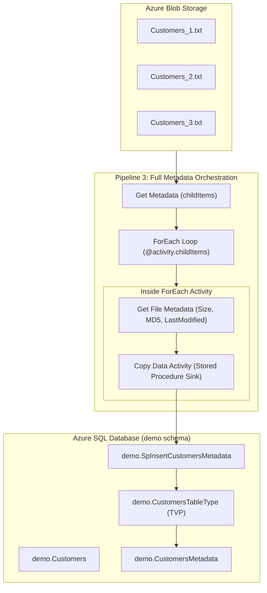

# Azure Data Factory: File and Pipeline Metadata Ingestion

Author: **Scott Peters** | [https://advancedsqlpuzzles.com](https://advancedsqlpuzzles.com)  
Companion SQL Scripts: [`Data Factory SQL DDL Scripts.sql`](file:///c:/Users/amitt/Documents/github/Advancesqlpuzzle/Microsoft%20Azure/Data%20Factory%20Metadata%20Demo/Data%20Factory%20SQL%20DDL%20Scripts.sql)

---

## Executive Summary

When designing enterprise data ingestion pipelines in Azure Data Factory (ADF) or Azure Synapse Analytics, capturing raw file data alone is insufficient for auditability, governance, and debugging. Enterprise compliance demands comprehensive metadata lineage:
- **File Metadata:** Item name, physical size, last modified timestamp, MD5 hash signature, structure, and column counts.
- **Pipeline Execution Metadata:** Factory name, pipeline name, unique Run ID, trigger type, trigger schedule, trigger name, and parent pipeline lineage.

This comprehensive guide walks through the architecture, configuration, and implementation of three progressive Azure Data Factory pipelines that ingest delimiter-separated text files into Azure SQL Database while enriching records with complete operational metadata via **Table-Valued Parameters (TVPs)**.

---

## Architecture Overview



---

## Core Concepts: Parameters vs. Variables

Understanding the architectural distinction between parameters and variables is essential for designing ADF pipelines:

| Feature | Parameters | User Variables | System Variables |
|:---|:---|:---|:---|
| **Definition** | External read-only arguments passed into resources. | Mutable memory locations scoped to the pipeline. | Predefined read-only system metadata. |
| **Mutability** | **Immutable** once execution begins. | **Mutable** via `Set Variable` or `Append Variable`. | **Immutable** runtime properties. |
| **Scope** | Pipelines, Datasets, Linked Services, Data Flows. | Pipeline internal logic only. | Pipeline execution context. |
| **Supported Types** | String, Int, Float, Bool, Array, Object. | String, Boolean, Array. | System values (Run ID, Trigger Time, etc.). |

### Built-in System Variables Reference

| System Variable Expression | Description |
|:---|:---|
| `@pipeline().DataFactory` | Name of the Data Factory or Synapse workspace running the pipeline. |
| `@pipeline().Pipeline` | Name of the pipeline. |
| `@pipeline().RunId` | Unique GUID identifying the specific execution run. |
| `@pipeline().TriggerType` | Type of trigger invoking execution (`ScheduleTrigger`, `BlobEventsTrigger`, `Manual`). |
| `@pipeline().TriggerId` | Unique ID of the trigger instance. |
| `@pipeline().TriggerName` | Name of the trigger that invoked the pipeline (or `Sandbox` in debug mode). |
| `@pipeline().TriggerTime` | UTC timestamp when the trigger fired. |
| `@pipeline().GroupId` | Unique ID grouping runs in parent/child pipeline orchestrations. |
| `@pipeline().TriggeredByPipelineName` | Name of parent caller pipeline (if triggered by `ExecutePipeline`). |
| `@pipeline().TriggerByPipelineRunId` | Run ID of parent caller pipeline. |

---

## Azure SQL Database Prerequisites

Before configuring ADF, execute [`Data Factory SQL DDL Scripts.sql`](file:///c:/Users/amitt/Documents/github/Advancesqlpuzzle/Microsoft%20Azure/Data%20Factory%20Metadata%20Demo/Data%20Factory%20SQL%20DDL%20Scripts.sql) against your Azure SQL Database:

### 1. Schema & User-Defined Table Type (UDTT)
```sql
IF SCHEMA_ID('demo') IS NULL
    EXEC('CREATE SCHEMA demo;');
GO

CREATE TYPE demo.CustomersTableType AS TABLE
(
    CustomerName VARCHAR(100) NOT NULL
);
GO
```

### 2. Destination Tables
```sql
CREATE TABLE demo.Customers
(
    InsertDate   DATETIME2(3) NOT NULL CONSTRAINT DF_Customers_InsertDate DEFAULT SYSDATETIME(),
    CustomerName VARCHAR(100) NULL
);
GO

CREATE TABLE demo.CustomersMetadata
(
    InsertDate                            DATETIME2(3) NOT NULL CONSTRAINT DF_CustMeta_Insert DEFAULT SYSDATETIME(),
    CustomerName                          VARCHAR(100) NULL,
    File_ItemName                         VARCHAR(260) NULL,
    File_ItemType                         VARCHAR(50)  NULL,
    File_Size                             BIGINT       NULL,
    File_LastModified                     DATETIME2(3) NULL,
    File_ContentMD5                       VARCHAR(32)  NULL,
    File_Structure                        VARCHAR(1000) NULL,
    File_ColumnCount                      INT          NULL,
    File_Exists                           BIT          NULL,
    System_DataFactoryName                VARCHAR(128) NULL,
    System_PipelineName                   VARCHAR(260) NULL,
    System_PipelineRunId                  VARCHAR(36)  NULL,
    System_PipelineTriggerType            VARCHAR(50)  NULL,
    System_PipelineTriggerId              VARCHAR(100) NULL,
    System_PipelineTriggerName            VARCHAR(260) NULL,
    System_PipelineTriggerTime            VARCHAR(50)  NULL,
    System_PipelineGroupID                VARCHAR(100) NULL,
    System_PipelineTriggeredByPipelineName VARCHAR(260) NULL,
    System_PipelineTriggerByPipelineRundId VARCHAR(36)  NULL
);
GO
```

### 3. Stored Procedure with Table-Valued Parameter
```sql
CREATE OR ALTER PROCEDURE demo.SpInsertCustomersMetadata
    @pCustomersTableType                   demo.CustomersTableType READONLY,
    @pFile_ItemName                        VARCHAR(260) = NULL,
    @pFile_ItemType                        VARCHAR(50)  = NULL,
    @pFile_Size                            BIGINT       = NULL,
    @pFile_LastModified                    DATETIME2(3) = NULL,
    @pFile_ContentMD5                      VARCHAR(32)  = NULL,
    @pFile_Structure                       VARCHAR(1000) = NULL,
    @pFile_ColumnCount                     INT          = NULL,
    @pFile_Exists                          BIT          = NULL,
    @pSystem_DataFactoryName               VARCHAR(128) = NULL,
    @pSystem_PipelineName                  VARCHAR(260) = NULL,
    @pSystem_PipelineRunId                 VARCHAR(36)  = NULL,
    @pSystem_PipelineTriggerType           VARCHAR(50)  = NULL,
    @pSystem_PipelineTriggerId             VARCHAR(100) = NULL,
    @pSystem_PipelineTriggerName           VARCHAR(260) = NULL,
    @pSystem_PipelineTriggerTime           VARCHAR(50)  = NULL,
    @pSystem_PipelineGroupID               VARCHAR(100) = NULL,
    @pSystem_PipelineTriggeredByPipelineName VARCHAR(260) = NULL,
    @pSystem_PipelineTriggerByPipelineRundId VARCHAR(36)  = NULL
AS
BEGIN
    SET NOCOUNT ON;

    INSERT INTO demo.CustomersMetadata
    (
        CustomerName, File_ItemName, File_ItemType, File_Size, File_LastModified,
        File_ContentMD5, File_Structure, File_ColumnCount, File_Exists,
        System_DataFactoryName, System_PipelineName, System_PipelineRunId,
        System_PipelineTriggerType, System_PipelineTriggerId, System_PipelineTriggerName,
        System_PipelineTriggerTime, System_PipelineGroupID,
        System_PipelineTriggeredByPipelineName, System_PipelineTriggerByPipelineRundId
    )
    SELECT
        c.CustomerName, @pFile_ItemName, @pFile_ItemType, @pFile_Size, @pFile_LastModified,
        @pFile_ContentMD5, @pFile_Structure, @pFile_ColumnCount, @pFile_Exists,
        @pSystem_DataFactoryName, @pSystem_PipelineName, @pSystem_PipelineRunId,
        @pSystem_PipelineTriggerType, @pSystem_PipelineTriggerId, @pSystem_PipelineTriggerName,
        @pSystem_PipelineTriggerTime, @pSystem_PipelineGroupID,
        @pSystem_PipelineTriggeredByPipelineName, @pSystem_PipelineTriggerByPipelineRundId
    FROM @pCustomersTableType c;
END;
GO
```

---

## The Three Progressive Pipelines

### Pipeline 1: Basic File Ingestion
- **Objective:** Ingest customer names from text files without custom metadata.
- **Components:**
  1. Dataset `source_directory`: DelimitedText in Azure Blob Storage with filename left blank.
  2. Dataset `Customers_table`: Azure SQL Database pointing to `demo.Customers`.
  3. Activity `Copy data`:
     - **Source:** `source_directory` with `Wildcard folder path` enabled (`*`).
     - **Sink:** `Customers_table` with direct insert.
     - **Mapping:** `CustomerName` $\rightarrow$ `CustomerName`.

---

### Pipeline 2: Passing Pipeline Execution Timestamp via TVP
- **Objective:** Stamp every ingested row with the exact UTC timestamp of the pipeline run (`@utcnow()`), rather than relying on server-side `GETDATE()`.
- **Components:**
  1. Stored Procedure: `demo.SpInsertCustomersTable`.
  2. Activity `Copy data`:
     - **Sink Dataset:** `Customers_table`.
     - **Sink Type:** Stored Procedure (`demo.SpInsertCustomersTable`).
     - **Table Type Parameter:** `pCustomersTableType`.
     - **Table Type Name:** `demo.CustomersTableType`.
     - **Parameter `@pInsertDate`:** `@utcnow()`.

> [!CAUTION]
> **Critical ADF Requirement - Two-Part Naming:**  
> In the Sink tab's **Table type** input box, you **MUST** specify the two-part name: `demo.CustomersTableType`. If you omit the schema and write only `CustomersTableType`, ADF fails with runtime error:
> `ErrorCode=2200, SqlException: Cannot find data type CustomersTableType`.

---

### Pipeline 3: Complete File & Pipeline Metadata Ingestion
- **Objective:** Iterate through incoming files, inspect their physical storage metadata, and commit rows with full lineage.
- **Workflow Steps:**
  1. **Get Metadata Activity (`Get File Names`):**
     - Dataset: `source_directory`
     - Field List: Add `Child items`. Returns an array of file objects: `[{name: "Customers_1.txt", type: "File"}, ...]`.
  2. **ForEach Activity (`ForEach Loop`):**
     - Items: `@activity('Get File Names').output.childItems`
  3. **Inside Loop - Parameterized Dataset (`source_parameter`):**
     - Parameter: `FileName` (String)
     - File Path: `source / Directory / @dataset().FileName`
  4. **Inside Loop - Get Metadata Activity (`Get File Metadata`):**
     - Dataset: `source_parameter` (passing `@item().name`)
     - Field List: Select `Item name`, `Item type`, `Size`, `Last modified`, `Content MD5`, `Structure`, `Column count`, `Exists`.
  5. **Inside Loop - Copy Data Activity (`Insert CustomersMetadata`):**
     - **Source:** `source_parameter` (passing `@item().name`).
     - **Sink:** `CustomersMetadata_table` using Stored Procedure `demo.SpInsertCustomersMetadata`.
     - **Sink Parameters Mapping:**
       - `pFile_ItemName` $\rightarrow$ `@activity('Get File Metadata').output.itemName`
       - `pFile_ItemType` $\rightarrow$ `@activity('Get File Metadata').output.itemType`
       - `pFile_Size` $\rightarrow$ `@activity('Get File Metadata').output.size`
       - `pFile_LastModified` $\rightarrow$ `@activity('Get File Metadata').output.lastModified`
       - `pFile_ContentMD5` $\rightarrow$ `@activity('Get File Metadata').output.contentMD5`
       - `pFile_Structure` $\rightarrow$ `@activity('Get File Metadata').output.structure`
       - `pFile_ColumnCount` $\rightarrow$ `@activity('Get File Metadata').output.columnCount`
       - `pFile_Exists` $\rightarrow$ `@activity('Get File Metadata').output.exists`
       - `pSystem_DataFactoryName` $\rightarrow$ `@pipeline().DataFactory`
       - `pSystem_PipelineName` $\rightarrow$ `@pipeline().Pipeline`
       - `pSystem_PipelineRunId` $\rightarrow$ `@pipeline().RunId`
       - `pSystem_PipelineTriggerType` $\rightarrow$ `@pipeline().TriggerType`
       - `pSystem_PipelineTriggerName` $\rightarrow$ `@pipeline().TriggerName`
       - `pSystem_PipelineTriggerTime` $\rightarrow$ `@pipeline().TriggerTime`
       - `pSystem_PipelineGroupID` $\rightarrow$ `@pipeline().GroupId`

> [!NOTE]
> In the Mapping tab of the Copy Data activity when using a Table-Valued Parameter Sink, a red `Failed` or `Import schemas` warning indicator is **expected and harmless**. Because ADF streams row data directly into the TVP parameter rather than individual SQL column bindings, schema mapping is handled by the stored procedure.

---

## Verification & Audit Output

Once executed, query `demo.CustomersMetadata` to review the audit trail:

```sql
SELECT CustomerName,
       File_ItemName,
       File_Size,
       File_ContentMD5,
       System_PipelineName,
       System_PipelineRunId,
       System_PipelineTriggerType
FROM   demo.CustomersMetadata;
```

### Sample Audit Record
| Column | Value |
|:---|:---|
| `InsertDate` | `2026-11-08 00:30:15.123` |
| `CustomerName` | `Alan Turing` |
| `File_ItemName` | `Customers_1.txt` |
| `File_Size` | `48` bytes |
| `File_ContentMD5` | `n05np0tEsV8zCIBKcC4wHg==` |
| `System_DataFactoryName` | `adf-datafactory-demo-01` |
| `System_PipelineName` | `Insert_Customers_Metadata` |
| `System_PipelineRunId` | `87fae8e9-492b-40b1-b9d0-d581989fa605` |
| `System_PipelineTriggerType`| `ScheduleTrigger` |
| `System_PipelineTriggerName`| `DailyIngestTrigger` |
