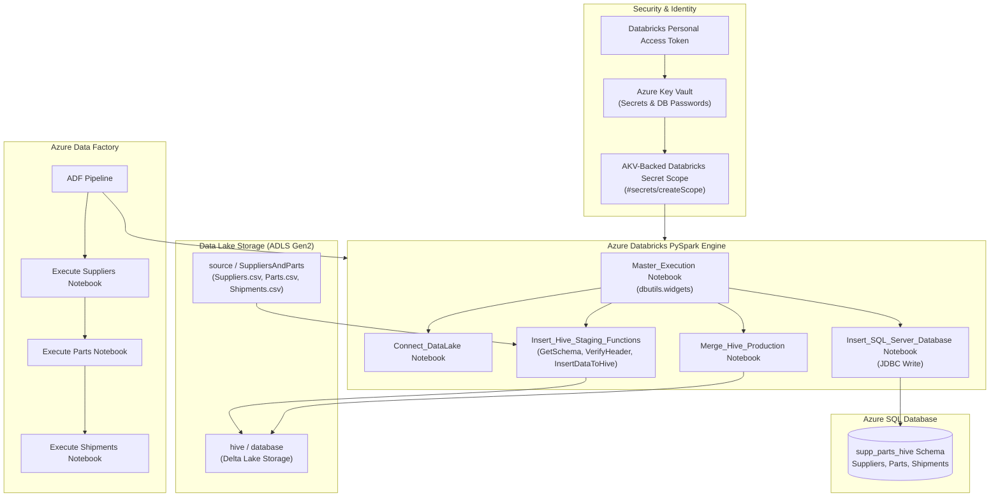

# Azure Databricks, PySpark & Delta Lake (Hive) End-to-End ETL Architecture

Author: **Scott Peters** | [https://advancedsqlpuzzles.com](https://advancedsqlpuzzles.com)  
Companion Artifacts: [`SuppliersAndParts.dbc`](file:///c:/Users/amitt/Documents/github/Advancesqlpuzzle/Microsoft%20Azure/Databricks%20Spark%20Hive%20Demo/SuppliersAndParts.dbc) | [`SuppliersAndPartsDDL.sql`](file:///c:/Users/amitt/Documents/github/Advancesqlpuzzle/Microsoft%20Azure/Databricks%20Spark%20Hive%20Demo/SuppliersAndPartsDDL.sql) | `Suppliers.csv`, `Parts.csv`, `Shipments.csv`

---

## Executive Summary

This architecture guide demonstrates how to build an enterprise-grade ETL pipeline combining **Azure Databricks**, **Apache Spark / Delta Lake (Hive metastore)**, **Azure Key Vault**, **Azure Data Lake Storage (ADLS Gen2)**, and **Azure SQL Database**, orchestrated end-to-end via **Azure Data Factory (ADF)**.

The workload ingests the classic relational benchmark dataset—**Suppliers, Parts, and Shipments** (introduced by C.J. Date)—from CSV storage in an Azure Data Lake, enforces strict schema validation and drift detection, stages and merges records into Delta Lake format, and publishes final relational outputs to an Azure SQL Database.

---

## Architecture Flowchart



---

## Azure Resource Provisioning Matrix

| Resource | Resource Name Pattern | Purpose |
|:---|:---|:---|
| **Resource Group** | `rg-databricks-hive-demo` | Central resource grouping. |
| **Azure Key Vault** | `akv-databricks-hive-demo` | Secure storage of DB credentials, ADLS storage keys, and API tokens. |
| **Azure Storage (ADLS Gen2)** | `dlsdatabrickshivedemo` | Hierarchical namespace storage container (`source` and `hive`). |
| **Azure Databricks** | `db-databricks-hive-demo` | Spark compute engine (Premium SKU required for Secret Scopes). |
| **Azure SQL Server** | `sql-databricks-hive-demo.database.windows.net` | Target relational database server. |
| **Azure SQL Database** | `sqldb-databricks-hive-demo` | Target relational database instance (`supp_parts_hive` schema). |
| **Azure Data Factory** | `adf-databricks-hive-demo` | Master workflow orchestrator. |

---

## Key Vault Secrets & Databricks Secret Scope

### 1. Azure Key Vault Secret Configuration

Store the following secrets in `akv-databricks-hive-demo`:

| Secret Name | Sample Value | Purpose |
|:---|:---|:---|
| `sqlServerName` | `sql-databricks-hive-demo.database.windows.net` | FQDN of the Azure SQL Server |
| `sqldbName` | `sqldb-databricks-hive-demo` | SQL Database name |
| `sqlUserName` | `dbadmin` | Administrative database user |
| `sqlPassword` | `YourSecurePassword!` | Administrative password |
| `sqljdbcPort` | `1433` | Standard SQL Server TDS port |
| `DataLakeName` | `dlsdatabrickshivedemo` | Storage account name |
| `DataLakeAccessKey` | `[Storage Account Primary Access Key]` | Storage authentication key |
| `DatabricksToken` | `dapi...` | Personal Access Token generated from Databricks |

### 2. Creating an AKV-Backed Secret Scope in Databricks
1. Log into your Azure Databricks workspace.
2. In your browser's address bar, append `#secrets/createScope` to the workspace URL (case-sensitive):  
   `https://<databricks-instance>#secrets/createScope`
3. Configure the Secret Scope:
   - **Scope Name:** `databricks-hive-demo-secret-scope`
   - **Manage Principal:** `Creator`
   - **DNS Name (Vault URI):** Copy from Azure Key Vault overview (e.g., `https://akv-databricks-hive-demo.vault.azure.net/`)
   - **Resource ID:** Copy from Azure Key Vault properties page (`/subscriptions/.../resourceGroups/.../providers/Microsoft.KeyVault/vaults/...`)
4. Click **Create**.

---

## ADLS Gen2 Storage Layout

Within storage account `dlsdatabrickshivedemo`, provision two containers:
1. **`source/`**:
   - Subfolder: `SuppliersAndParts/`
   - Files uploaded: `Suppliers.csv`, `Parts.csv`, `Shipments.csv`
2. **`hive/`**:
   - Subfolder: `database/`
   - Dedicated physical storage for Delta Lake tables.

---

## PySpark Notebook Implementations

The companion archive [`SuppliersAndParts.dbc`](file:///c:/Users/amitt/Documents/github/Advancesqlpuzzle/Microsoft%20Azure/Databricks%20Spark%20Hive%20Demo/SuppliersAndParts.dbc) contains the complete modular notebook suite:

### 1. `Connect_DataLake`
Connects Databricks to Key Vault and mounts ADLS Gen2 storage using Spark configurations:
```python
scopename = "databricks-hive-demo-secret-scope"
datalakename = dbutils.secrets.get(scope=scopename, key="DataLakeName")
TablePathHive = f"abfss://hive@{datalakename}.dfs.core.windows.net/database/"

# Database JDBC Connection Configuration
DBServer = dbutils.secrets.get(scope=scopename, key="sqlServerName")
dbServerUserName = dbutils.secrets.get(scope=scopename, key="sqlUserName")
dbServerPassword = dbutils.secrets.get(scope=scopename, key="sqlPassword")
DBName = dbutils.secrets.get(scope=scopename, key="sqldbName")
jdbcPort = dbutils.secrets.get(scope=scopename, key="sqljdbcPort")

url = f"jdbc:sqlserver://{DBServer}:{jdbcPort};database={DBName}"
properties = {"user": dbServerUserName, "password": dbServerPassword}

# Authenticate Spark to Data Lake
datalake_key = dbutils.secrets.get(scope=scopename, key="DataLakeAccessKey")
spark.conf.set(f"fs.azure.account.key.{datalakename}.dfs.core.windows.net", datalake_key)
spark.conf.set(f"fs.azure.account.key.{datalakename}.blob.core.windows.net", datalake_key)
```

### 2. `Create_Database` & `Create_Tables`
Initializes the Hive metastore database and creates physical Delta Lake tables:
```sql
-- Create Hive Database
DROP DATABASE IF EXISTS demo CASCADE;
CREATE DATABASE IF NOT EXISTS demo
LOCATION '/demo/database';

-- Create Production Delta Tables
CREATE TABLE IF NOT EXISTS demo.Suppliers
(
    SupplierId   NUMERIC(4,0),
    SupplierName STRING,
    Status       NUMERIC(4,0),
    City         STRING,
    InsertDate   TIMESTAMP
)
USING DELTA
LOCATION "abfss://hive@dlsdatabrickshivedemo.dfs.core.windows.net/database/Suppliers/delta/";
```

### 3. `Insert_Hive_Staging_Functions`
Implements strict schema validation, header consistency checks, and idempotent staging table loads:
```python
from pyspark.sql.types import StructType, StructField, StringType

def GetSchema(Name):
    if Name == "Suppliers":
        return StructType([
            StructField("SupplierId", StringType()),
            StructField("SupplierName", StringType()),
            StructField("Status", StringType()),
            StructField("City", StringType())
        ])

def VerifyHeader(df, new_df):
    for idx1, col1 in enumerate(df.dtypes):
        for idx2, col2 in enumerate(new_df.dtypes):
            if idx1 == idx2:
                if col1[0] != col2[0]:
                    raise ValueError(f"Schema mismatch: Expected {col1[0]}, got {col2[0]}")

def ProcessHiveStagingData(FilePath, ProcessName):
    # Read CSV with schema validation
    df = spark.read.csv(
        f"wasbs://source@{datalakename}.blob.core.windows.net{FilePath}",
        sep=",",
        mode="DROPMALFORMED",
        schema=GetSchema(ProcessName)
    )
    
    # Verify header
    new_df = GenerateIncomingDataHeader(df.limit(1))
    VerifyHeader(df, new_df)
    
    # Save to staging Delta table (Truncate and Overwrite)
    TableName = ProcessName + "Stage"
    df.write.mode("overwrite") \
      .option("truncate", True) \
      .option("overwriteSchema", "true") \
      .format("delta") \
      .saveAsTable(f"demo.{TableName}")
```

### 4. `Insert_SQL_Server_Database`
Pushes validated Delta Lake records downstream into Azure SQL Database via Spark JDBC:
```python
if ProcessName == "Suppliers":
    df = spark.sql("SELECT SupplierId, SupplierName, Status, City FROM demo.Suppliers")
    df.write.mode("overwrite") \
      .option("truncate", True) \
      .jdbc(url=url, table="supp_parts_hive.Suppliers", properties=properties)
```

### 5. `Master_Execution`
Reads dynamic pipeline variables from ADF using `dbutils.widgets` and executes the pipeline sequence:
```python
dbutils.widgets.text("ProcessName", "")
dbutils.widgets.text("FileName", "")

ProcessName = dbutils.widgets.get("ProcessName")
FileName = dbutils.widgets.get("FileName")

ProcessHiveStagingData(FileName, ProcessName)
```

---

## Azure Data Factory Orchestration

1. **Create Linked Services:**
   - **Azure Key Vault Linked Service:** Connects to `akv-databricks-hive-demo` using Managed Identity.
   - **Databricks Linked Service:** Connects to workspace using the Personal Access Token retrieved dynamically from AKV (`@activity('...').output...`). Select **New Job Cluster** (`Standard_DS3_v2`, 1 worker) to minimize idle compute costs.
2. **Author Pipeline with Sequential Execution:**
   - Chain three **Databricks Notebook Activities**:
     1. `Execute Suppliers` (`/SuppliersAndParts/Master_Execution`)
        - `FileName` = `/SuppliersAndParts/Suppliers.csv`
        - `ProcessName` = `Suppliers`
     2. `Execute Parts`
        - `FileName` = `/SuppliersAndParts/Parts.csv`
        - `ProcessName` = `Parts`
     3. `Execute Shipments`
        - `FileName` = `/SuppliersAndParts/Shipments.csv`
        - `ProcessName` = `Shipments`

> [!TIP]
> **Avoid Cluster Contention:**  
> Chaining the activities sequentially in ADF avoids the common Databricks error: `Unexpected failure while waiting for the cluster`.

---

## Audit & Verification Queries

Run the queries in [`SuppliersAndPartsDDL.sql`](file:///c:/Users/amitt/Documents/github/Advancesqlpuzzle/Microsoft%20Azure/Databricks%20Spark%20Hive%20Demo/SuppliersAndPartsDDL.sql) against Azure SQL Database to verify complete data ingestion:

```sql
SELECT * FROM supp_parts_hive.Suppliers;
SELECT * FROM supp_parts_hive.Parts;
SELECT * FROM supp_parts_hive.Shipments;
```

To review table version history and audit logs directly inside Databricks:
```sql
DESCRIBE HISTORY demo.Suppliers;
```

