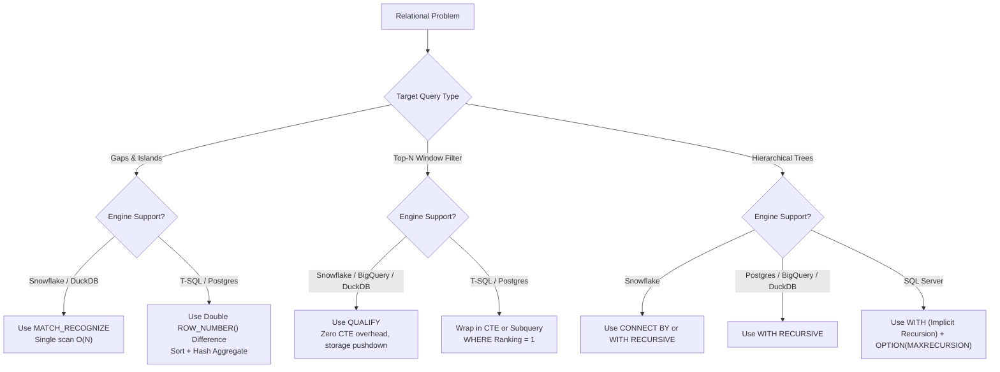

# 🌐 Multi-Dialect SQL Architecture & Cross-Engine Guide

> **Author:** Amitkumar Tiwari  
> **Engine Targets:** Microsoft SQL Server (T-SQL) • PostgreSQL 16+ • Snowflake • Google BigQuery • DuckDB  
> **Repository:** [Advancesqlpuzzle](https://github.com/Amit1092tiwari/Advancesqlpuzzle)

---

## Executive Summary

While SQL is standardized under ANSI/ISO conventions, modern enterprise data stacks are highly polyglot. Data engineers and database architects routinely transition across:
- **OLTP / Hybrid Engines:** Microsoft SQL Server (T-SQL), PostgreSQL.
- **Cloud Analytics Data Warehouses:** Snowflake, Google BigQuery, Databricks Spark SQL.
- **Embedded / In-Memory Vector & Analytical Engines:** DuckDB.

This guide provides deep architectural translations and benchmarked solution strategies for the hardest relational database problem archetypes, highlighting syntax divergences, optimizer behavior, and proprietary dialect superpowers.

---

## Dialect Capability Matrix

| Architectural Feature | Microsoft SQL Server (T-SQL) | PostgreSQL (16+) | Snowflake | Google BigQuery | DuckDB |
| :--- | :---: | :---: | :---: | :---: | :---: |
| **Window Filtering (`QUALIFY`)** | ❌ (Requires CTE/Subquery) | ❌ (Requires CTE/Subquery) | ✅ Native | ✅ Native | ✅ Native |
| **Row Pattern (`MATCH_RECOGNIZE`)** | ❌ | ❌ | ✅ Native | ❌ | ✅ Native |
| **Recursive Syntax** | `WITH cte AS (...)` | `WITH RECURSIVE cte AS (...)` | `WITH RECURSIVE` or `CONNECT BY` | `WITH RECURSIVE cte AS (...)` | `WITH RECURSIVE cte AS (...)` |
| **Conditional Aggregation** | `SUM(CASE WHEN ...)` | `SUM(...) FILTER (WHERE ...)` | `SUM(IFF(...))` or `CASE WHEN` | `COUNTIF(...)` or `SUM(CASE WHEN ...)` | `SUM(...) FILTER (WHERE ...)` |
| **Array & Struct Native Primitives** | ❌ (JSON strings) | ✅ Native Arrays | ✅ Native Arrays / Variants | ✅ Native Arrays / Structs | ✅ Native Lists / Structs |
| **Set Difference** | `EXCEPT` | `EXCEPT` | `EXCEPT` / `MINUS` | `EXCEPT DISTINCT` | `EXCEPT` |
| **Pivoting Operator** | `PIVOT` | `crosstab` (tablefunc) | `PIVOT` | `PIVOT` | `PIVOT` |

---

## Paradigm 1: Gaps & Islands (Puzzle #6: Workflow Steps)

### The Problem
Identify continuous execution intervals (islands) and detect when an agent or workflow step transitioned across distinct states over time.

```text
Input:
WorkflowID | StepNumber | Status
1          | 1          | Complete
1          | 2          | Complete
1          | 3          | Error
1          | 4          | Complete
```

---

### Strategy A: The Classic Double `ROW_NUMBER()` Offset (T-SQL & PostgreSQL)
In engines without row-pattern recognition, islands are calculated by taking the difference between an unbroken sequence and a partitioned sequence. As long as `Status` remains unchanged, `StepNumber - ROW_NUMBER()` yields an invariant island identifier:

```sql
-- Valid on: SQL Server (T-SQL) & PostgreSQL
WITH RankedSteps AS (
    SELECT  WorkflowID,
            StepNumber,
            Status,
            StepNumber - ROW_NUMBER() OVER (
                PARTITION BY WorkflowID, Status 
                ORDER BY StepNumber
            ) AS IslandGroup
    FROM    WorkflowSteps
)
SELECT  WorkflowID,
        Status,
        MIN(StepNumber) AS StartStep,
        MAX(StepNumber) AS EndStep,
        COUNT(*) AS StepCount
FROM    RankedSteps
GROUP BY WorkflowID, Status, IslandGroup
ORDER BY WorkflowID, StartStep;
```

---

### Strategy B: Native Row Pattern Matching `MATCH_RECOGNIZE` (Snowflake & DuckDB)
Snowflake and DuckDB implement ANSI SQL:2016 `MATCH_RECOGNIZE`, allowing regular-expression-like state pattern matching directly over row streams without intermediate window CTEs or self-joins:

```sql
-- Valid on: Snowflake & DuckDB
SELECT  WorkflowID,
        Status,
        StartStep,
        EndStep,
        StepCount
FROM    WorkflowSteps
MATCH_RECOGNIZE (
    PARTITION BY WorkflowID
    ORDER BY StepNumber
    MEASURES
        FIRST(Status) AS Status,
        FIRST(StepNumber) AS StartStep,
        LAST(StepNumber) AS EndStep,
        COUNT(*) AS StepCount
    ONE ROW PER MATCH
    PATTERN (SAME_STATUS+)
    DEFINE
        SAME_STATUS AS Status = PREV(Status) OR PREV(Status) IS NULL
)
ORDER BY WorkflowID, StartStep;
```
> **Architectural Note:** `MATCH_RECOGNIZE` executes in a single streaming scan over sorted data, eliminating the hash aggregate and sort spills often provoked by the double-window technique.

---

## Paradigm 2: Window Function Filtering (`QUALIFY` vs. CTE Wrapping)

### The Problem (Puzzle #25: Top Vendors / Puzzle #31: Second Highest)
Retrieve rows matching top-N criteria (e.g. highest salary per department, second highest vendor) without unnecessary subquery ceremony.

---

### T-SQL & PostgreSQL: Mandatory Derived Table or CTE Wrapping
ANSI SQL forbids referencing window functions in the `WHERE` or `HAVING` clauses because logical processing evaluates `WHERE` before `SELECT` (where window functions are computed):

```sql
-- T-SQL & PostgreSQL
WITH RankedVendors AS (
    SELECT  OrderID,
            VendorID,
            Amount,
            DENSE_RANK() OVER (
                PARTITION BY VendorID 
                ORDER BY Amount DESC
            ) AS Ranking
    FROM    VendorOrders
)
SELECT  OrderID,
        VendorID,
        Amount
FROM    RankedVendors
WHERE   Ranking = 1;
```

---

### Snowflake, Google BigQuery, & DuckDB: Native `QUALIFY` Clause
Modern analytical engines introduce `QUALIFY`, executed logically immediately after the `SELECT` window calculation, stripping out CTE boilerplate:

```sql
-- Valid on: Snowflake, Google BigQuery, and DuckDB
SELECT  OrderID,
        VendorID,
        Amount
FROM    VendorOrders
QUALIFY DENSE_RANK() OVER (PARTITION BY VendorID ORDER BY Amount DESC) = 1;
```
> **Optimizer Impact:** In BigQuery and Snowflake, `QUALIFY` enables the query planner to push top-N window filters down to storage shards, avoiding the materialization of millions of non-qualifying rows.

---

## Paradigm 3: Relational Division & Set Comparison (Puzzle #1: Shopping Carts)

### The Problem
Compare two carts (`#Cart1` and `#Cart2`) and determine if their items match exactly, disjointly, or intersect.

---

### T-SQL: Bidirectional `EXCEPT` & `FULL OUTER JOIN`
T-SQL relies on set subtraction (`EXCEPT`) or a single-pass `FULL OUTER JOIN`:

```sql
-- T-SQL Set Comparison
SELECT  Item AS Cart1_Item, NULL AS Cart2_Item FROM #Cart1
EXCEPT
SELECT  Item, NULL FROM #Cart2
UNION ALL
(
    SELECT  NULL, Item FROM #Cart2
    EXCEPT
    SELECT  NULL, Item FROM #Cart1
);
```

---

### PostgreSQL: Native Array Aggregation & Array Equality
PostgreSQL supports first-class array types. We can sort items into an array and compare sets with the `=` array equality operator:

```sql
-- PostgreSQL Array Set Comparison
WITH Cart1_Agg AS (
    SELECT ARRAY_AGG(Item ORDER BY Item) AS Items FROM Cart1
),
Cart2_Agg AS (
    SELECT ARRAY_AGG(Item ORDER BY Item) AS Items FROM Cart2
)
SELECT  c1.Items AS Cart1_Items,
        c2.Items AS Cart2_Items,
        CASE 
            WHEN c1.Items = c2.Items THEN 'Exact Match'
            WHEN c1.Items && c2.Items THEN 'Partial Overlap'
            ELSE 'Disjoint'
        END AS MatchStatus
FROM    Cart1_Agg c1 
CROSS JOIN Cart2_Agg c2;
```

---

### Google BigQuery: `ARRAY_AGG` and `ARRAY_TO_STRING` Hashing
BigQuery lacks `FULL OUTER JOIN` on non-equality expressions, but excels at array transformations:

```sql
-- Google BigQuery
WITH CartsCombined AS (
    SELECT 'Cart1' AS Source, Item FROM Cart1
    UNION ALL
    SELECT 'Cart2' AS Source, Item FROM Cart2
),
GroupedByItem AS (
    SELECT  Item,
            COUNTIF(Source = 'Cart1') AS InCart1,
            COUNTIF(Source = 'Cart2') AS InCart2
    FROM    CartsCombined
    GROUP BY Item
)
SELECT  Item,
        CASE 
            WHEN InCart1 > 0 AND InCart2 > 0 THEN 'Both Carts'
            WHEN InCart1 > 0 THEN 'Cart 1 Only'
            ELSE 'Cart 2 Only'
        END AS Presence
FROM    GroupedByItem;
```

---

## Paradigm 4: Hierarchical Graphs & Recursion (Puzzle #2: Managers & Employees)

### The Problem
Traverse a self-referencing employee hierarchy, calculating reporting depth and the complete organizational path.

---

### T-SQL: Implicit Recursion `WITH`
T-SQL does not require (and does not accept) the `RECURSIVE` keyword. Recursion is inferred by referencing the CTE name inside its definition:

```sql
-- Microsoft SQL Server T-SQL
WITH EmployeeHierarchy AS (
    -- Anchor Member
    SELECT  EmployeeID,
            ManagerID,
            JobTitle,
            Salary,
            0 AS Depth,
            CAST(EmployeeID AS VARCHAR(MAX)) AS OrgPath
    FROM    #Employees
    WHERE   ManagerID IS NULL

    UNION ALL

    -- Recursive Member
    SELECT  e.EmployeeID,
            e.ManagerID,
            e.JobTitle,
            e.Salary,
            h.Depth + 1,
            CAST(h.OrgPath + ' -> ' + CAST(e.EmployeeID AS VARCHAR(30)) AS VARCHAR(MAX))
    FROM    #Employees e
    INNER JOIN EmployeeHierarchy h ON e.ManagerID = h.EmployeeID
)
SELECT  EmployeeID, ManagerID, JobTitle, Salary, Depth, OrgPath
FROM    EmployeeHierarchy
ORDER BY Depth, EmployeeID
OPTION (MAXRECURSION 100);
```

---

### PostgreSQL, DuckDB, & BigQuery: Mandatory `WITH RECURSIVE`
ANSI standard compliance requires the explicit `RECURSIVE` keyword:

```sql
-- PostgreSQL, DuckDB, & BigQuery
WITH RECURSIVE EmployeeHierarchy AS (
    -- Anchor Member
    SELECT  EmployeeID,
            ManagerID,
            JobTitle,
            Salary,
            0 AS Depth,
            CAST(EmployeeID AS TEXT) AS OrgPath
    FROM    Employees
    WHERE   ManagerID IS NULL

    UNION ALL

    -- Recursive Member
    SELECT  e.EmployeeID,
            e.ManagerID,
            e.JobTitle,
            e.Salary,
            h.Depth + 1,
            h.OrgPath || ' -> ' || CAST(e.EmployeeID AS TEXT)
    FROM    Employees e
    INNER JOIN EmployeeHierarchy h ON e.ManagerID = h.EmployeeID
)
SELECT  EmployeeID, ManagerID, JobTitle, Salary, Depth, OrgPath
FROM    EmployeeHierarchy
ORDER BY Depth, EmployeeID;
```

---

### Snowflake: Native `CONNECT BY` Hierarchical Traversal
Snowflake supports both `WITH RECURSIVE` and Oracle-style `CONNECT BY` expressions, which avoid CTEs entirely:

```sql
-- Snowflake Native CONNECT BY
SELECT  EmployeeID,
        ManagerID,
        JobTitle,
        Salary,
        LEVEL - 1 AS Depth,
        SYS_CONNECT_BY_PATH(EmployeeID, ' -> ') AS OrgPath
FROM    Employees
START WITH ManagerID IS NULL
CONNECT BY PRIOR EmployeeID = ManagerID
ORDER BY Depth, EmployeeID;
```

---

## Paradigm 5: Conditional Aggregation & Pivot Mechanics (Puzzle #4: Two Predicates)

### The Problem
Find customers who placed orders in `'CA'` AND also placed orders in `'TX'`.

---

### Dialect Syntax Comparison

| Engine | Query Formulation |
| :--- | :--- |
| **PostgreSQL** | `SELECT CustomerID FROM Orders GROUP BY CustomerID HAVING COUNT(*) FILTER (WHERE DeliveryState = 'CA') > 0 AND COUNT(*) FILTER (WHERE DeliveryState = 'TX') > 0;` |
| **BigQuery** | `SELECT CustomerID FROM Orders GROUP BY CustomerID HAVING COUNTIF(DeliveryState = 'CA') > 0 AND COUNTIF(DeliveryState = 'TX') > 0;` |
| **Snowflake** | `SELECT CustomerID FROM Orders GROUP BY CustomerID HAVING COUNT_IF(DeliveryState = 'CA') > 0 AND COUNT_IF(DeliveryState = 'TX') > 0;` |
| **T-SQL** | `SELECT CustomerID FROM #Orders GROUP BY CustomerID HAVING SUM(CASE WHEN DeliveryState = 'CA' THEN 1 ELSE 0 END) > 0 AND SUM(CASE WHEN DeliveryState = 'TX' THEN 1 ELSE 0 END) > 0;` |

---

## Dialect Execution Summary & Recommendation Matrix



---

*This guide is maintained as part of the [Advanced SQL Puzzles & Database Engineering Architecture](https://github.com/Amit1092tiwari/Advancesqlpuzzle).*
